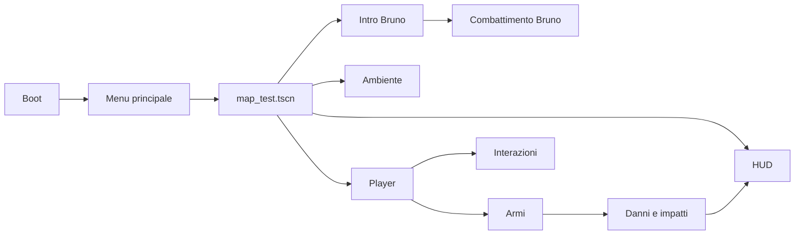

# Project Blob — architettura operativa

**SceneTransition condiviso, 10/10/2026:** load_scene(path, caption, show_loading) mostra prima la UI e carica PackedScene in thread; lascia copertura attiva al chiamante. transition_to cambia scena e attende inizializzazione; SaveManager usa lo stesso loader, ripristina inventario/player/partecipanti prima di reveal. Stage risorse 0–88, preparazione 90, ripristino 95, pronto 100; percentuale interpolata. PROCESS_MODE_ALWAYS e tween pausa PROCESS mantengono animazione durante restore. cancel_loading rilascia overlay e busy sugli errori. LoadingBlob disegna contorno deformabile e orbite; cornice e tema riusano inventario/menu.

**Collider player nella regia, 10/10/2026:** durante setup RegiaIntegration duplica la CapsuleShape3D del player e applica `player_passage_radius=0.35`, compatibile con i vani 0.795 m. Altezza e transizioni crouch conservate; player.tscn/player.gd invariati, altre scene mantengono default 0.4. La shape è locale all'istanza e ricostruita anche nel restore.

**Integrazione regia 10/10/2026:** `map_test/RegiaIntegration` → `regia_map_integration.gd` costruisce wrapper runtime delle tre porte/PC usando i visuali esistenti, aggiunge BossLootDrop e PersistentObject sui target reali. Mesh mobili e collider sotto AnimatableBody3D; frame fisso conservato. Creazione differita prima del restore; ID `main.*`, slot principale. Pannello regia e sei maniglie sotto pivot comune; SlidingKeyDoor ora accetta required_key vuoto. [Contratti e percorsi verificati](REGIA_MAP_INTEGRATION.md).

**Collisione Parete_013, correzione 10/10/2026:** `map_test/connesi_building_test2/Mura Interne Alte/Parete_013/StaticBody3D/CollisionShape3D` usa `resources/collision/parete_013_current.tres`, generata dalla mesh attuale. Il precedente concavo incorporato era geometricamente diverso e bloccava Bruno. Visiva/gruppi/transforms/navmesh/AI invariati. [Evidenze e generatore](BRUNO_PASSAGE_COLLISION.md).

**Integrazione bocca reale 10/10/2026:** `bruno_buozzi.tscn/MouthIntegration` scopre il controller intro il cui riferimento `bruno` coincide col parent; collega dialogue_player, boss_voice_player e BrunoDeathAudio sotto boss. Una sola istanza BrunoMouthMotion e un bus capture privato commutano voce con priorità morte > dialogo > combattimento, ripristinando routing precedente. Head V2 sostituita solo runtime, materiale/transforms originali mantenuti. Risata da animazione `laugh`, reazioni dolore/caduta/morte senza sorriso. Nessun nuovo segnale o modifica alla logica boss/cinematica.

**Bocca espressiva, revisione locale:** preview carica `mouth_preview_v2/bruno_head_mouth_preview.glb` (open/round/smile). Il controller audio pilota apertura e variazioni stilizzate; `laughing` attiva sorriso e apertura maggiore. Solo la preview imposta questo flag sul tempo 11.55 s della prima voce, verificato nel controller intro; non esiste riconoscimento automatico delle risate. Originale e precedente head-only conservati.

**Estensione isolata 10/10/2026:** [prova bocca Bruno](BRUNO_MOUTH_PREVIEW.md). `bruno_mouth_test.tscn` → `bruno_mouth_preview.gd` → istanza visuale del boss senza AI → nuova mesh head-only sul nodo originale `mixamorig_Head/output_unwrapped`. `BrunoMouthMotion` misura la voce su bus privato e pilota `mouth_open`; nessun collegamento nuovo alla cinematica reale.

Aggiornamento 08/10/2026: analisi statica locale e [baseline](BASELINE_SAFE_2026-10-08.md). Non è un audit completo di ogni nodo né un playtest.

## Avvio e sistemi globali

`project.godot` punta a `uid://cp2iy3c4fy8en`, risolto in `scenes/ui/boot.tscn`. `boot.gd` mostra i loghi e apre `scenes/ui/main_menu.tscn`; `main_menu.gd` avvia `scenes/maps/map_test.tscn`.

| Autoload | Risorsa | Responsabilità |
|---|---|---|
| SettingsManager | `scripts/systems/settings_manager.gd` | Settings persistenti, display, rendering, volumi |
| AudioManager | `scripts/systems/audio_manager.gd` | Bus, routing, musica menu |
| SceneTransition | `scripts/systems/scene_transition.gd` | Overlay, dissolvenze, caricamento threaded, cambio scena |
| PauseMenu | `scenes/ui/pause_menu.tscn` | Pausa, opzioni, ritorno menu |

Configurazione locale: feature Godot 4.7, fisica Jolt, driver Windows D3D12, viewport 1920×1080 e stretch `canvas_items`/`expand`. Godot 4.7.2 è riportato da README/PDF; eseguibile presente ma non avviato.

La mappa compone player/HUD, edificio, porte, TV/telecomando, impianto elettrico e insegna Connesi, scala, pickup, incendi/fumo, meteorite, intro Bruno, racchetta, boss, luci e ambiente combattimento. L'esistenza degli altri nemici e dei test VFX non dimostra che siano istanziati qui.

## Player, armi e impatti

`scripts/player/player.gd` estende `CharacterBody3D`: input, movimento, salute/morte, accovacciamento, passi e voce. Gruppo `player`. Riferimenti verificati: `Head`, `Head/Camera3D`, `Head/Camera3D/WeaponHolder`, `Head/Camera3D/InteractRay`, `CollisionShape3D`, `FootstepRay`, audio/timer passi. Leggere la scena prima di cambiarne la gerarchia.

| Comando | Input corrente |
|---|---|
| Movimento | WASD |
| Salto / sprint / accovacciamento | Spazio / Shift / Ctrl |
| Interazione | E |
| Sparo / ricarica | Mouse sinistro / R |
| Slot | 1–4; slot 4 gestito anche con controllo diretto del tasto |
| Torcia | F |
| Pausa | `ui_cancel` |
| Continua dopo morte | C, solo con file valido della scena corrente |
| Ricomincia dopo morte | N, sempre dall'inizio; file salvato conservato |

Predefiniti player: salute 100, velocità camminata 5, sprint 8, crouch 2,8. Il player inoltra i comandi al controller `scripts/weapons/weapon.gd`, che governa slot, possesso, munizioni, animazioni, audio, viewmodel, melee e batterie.

| Parametro predefinito nello script armi | Valore |
|---|---|
| Pistola | Danno 1, 4 colpi/s, caricatore 9, riserva 36 |
| SMG | Danno 4, 10 colpi/s, caricatore 30, riserva 120 |
| Melee | Danno 1, portata 1,6, cooldown 0,45 s |
| Torcia | Consumo 2/s, massimo 5 batterie di riserva |
| Muzzle flash | Durata 0,05 s |

Gli export possono essere sovrascritti nelle scene. Marker verificati in `scenes/player/player.tscn`: `PistolSocket/PistolMuzzleMarker` e `SMGSocket/SMGMuzzleMarker` sotto il rig braccia del viewmodel.

Pistola/SMG sono hitscan via `weapon_ray`, distinti dai proiettili di nemici/boss. Contratto danni: eventuale `try_dodge_shot(hit_point)`, quindi `take_bullet_hit(base_damage, hit_point)` o fallback `take_damage(amount)`; feedback hitmarker e numeri danno. Preservare l'eccezione al player nel raycast.

`spawn_bullet_impact()` usa `ImpactManager_Runtime`, gestore condiviso creato da `scripts/effects/impact_manager.gd`. Gli impatti leggono `surface_type` sul collider. I passi cercano invece gruppi `surface_rock`, `surface_tile`, `surface_parquet` su collider e antenati: preservare entrambi i contratti.

## Interazioni e scala

`scripts/systems/interaction_system.gd` risale dal collider ai genitori cercando `get_interaction_name()`, `get_interaction_action()` e `interact(player)`. Colore e focus sono opzionali: `get_interaction_color()` e `set_interaction_focus(enabled)`.

`scenes/ui/interaction_system.tscn` è montata nel player; ray path predefinito `../Head/Camera3D/InteractRay`. Il codice locale libera focus/prompt prima del pickup e sospende focus se `Interface` della HUD è nascosta: presente, runtime da confermare.

La scala usa `scripts/interactables/ladder.gd`: root `Node3D`, `InteractionBody/CollisionShape3D`, quattro `Marker3D` chiamati `BottomAttach`, `TopAttach`, `BottomExit`, `TopExit`. Layer interazione 2/mask 0, collider fisico separato. Marker riferiti ai piedi, uscite su pavimento solido fuori dai collider. Input/movimento FPS e collisioni vengono sospesi durante la salita e ripristinati all'uscita. [LEGGIMI_SCALA.txt](../LEGGIMI_SCALA.txt) conserva la procedura V1: verificarla contro il codice corrente, senza assumere che ogni istruzione storica sia ancora applicata.

## HUD e volto

`scripts/systems/hud.gd` aggiorna salute, arma, munizioni, batterie, missione, feedback, morte e boss; gruppo `hud`.

`HudFaceController` (`scripts/systems/hud_face_controller.gd`) estende `TextureRect` ed è collegato a `Interface/HudBar/FacePortrait` in `scenes/ui/hud.tscn`. Gruppo `player_face`, API `set_health(current,max)` e `react(name,severity)`. Immagini `assets/ui/face/stato1_1.png` … `stato4_20.png`.

Quattro stati con soglie predefinite 75/50/25%, 20 frame ciascuno. Priorità: idle 0, focus 30, pickup_small 50, pickup_major 60, hit 80, critical 100. Preservare l'interruzione da danno e l'anti-restart durante raffica SMG.

TESTATO UTENTE secondo PDF: pickup_major per pistola/SMG/torcia, pickup_small per munizioni/batteria accettata, determined per sparo, grunt per melee e dolore. `alert`/`focus` sono disponibili, non automaticamente collegati. `hit_random` non implementa danno direzionale reale. Tabella frame completa nella baseline.

## Nemici, Bruno e cinematica

`scenes/enemies/bruno_buozzi.tscn` usa `scripts/enemies/bruno_buozzi.gd`, `NavigationAgent3D`, stati cinematici/combat, racchetta, tennis/onda, scudo, percezione, anti-incastro, animazioni e tre segmenti salute.

Default script: `max_health=180`, headshot height 1,55/multiplier 2. La scena locale imposta `max_health=90` e `start_active=false`. La segmentazione usa `ceil(max_health/3)`. Leggere anche gli override mappa prima di concludere i valori runtime.

`scripts/cinematics/bruno_intro_controller.gd` gestisce camera/marker, TV e ducking, dialoghi, movimento/animazioni, blackout/rivelazione, blocco player, visibilità HUD e avvio boss. `scripts/vfx/bruno_fight_environment.gd` e `scripts/environment/bruno_boss_spotlight.gd` governano musica, luce e ripristino ambiente. Preservare i gruppi `bruno_intro_blocker` e `navigation_source`.

IA base: `scripts/enemies/enemy.gd`, rilevamento/memoria/LOS, inseguimento, melee, schivata e magie. Varianti Carloni e copie storiche vanno distinte dai riferimenti attivi prima di interventi o eliminazioni.

## Maglietta BetterBuozzi — aggiornamento 08/10/2026

Il corpo usa la nuova texture BetterBuozzi_Meshy_AI_Mutated_Tennis_Player_1004142620_texture_connesi.png tramite BetterBuozzi_connesi_material.tres, come surface_material_override/0 in scenes/enemies/bruno_buozzi.tscn sul nodo BetterBuozzi/Armature/GeneralSkeleton/Meshy_AI_Mutated_Tennis_Player_1004142620_texture. GLB e texture originale restano inalterati; il solo GLB conserva l'aspetto originale. La scritta è incorporata nelle UV e segue le animazioni senza nuovi nodi o script runtime. Parametri e verifiche nella [nota asset](BETTERBUOZZI_CONNESI_TEXTURE.md).

## Materiale dell'onda — aggiornamento 08/10/2026

L'onda attiva è assets/vfx/bruno_melee_banana3d/bruno_melee_banana3d.tscn. Core e Shell usano magical_waterball_fire_godot4.gdshader: superficie lilla con noise locale continuo, pulsazione 1,2 Hz / 18% e deformazione radiale 0,06 / velocità 0,8. Entrambi gli strati condividono fase e deformazione, attenuata alle estremità; il margine di culling 0,25 copre lo spostamento della configurazione corrente.

I parametri dissolve ed emission_boost mantengono il contratto del controller. La luminosità viene applicata all'ALBEDO HDR perché il render mode unshaded mostra direttamente quel colore. Nessuna modifica a traiettoria, crescita, durata, volume di danno o ostacoli. L'anteprima usa start_wave() con danno disabilitato.

## Impostazioni, audio e risorse

### Inventario e checkpoint — 10/10/2026

Tre autoload dopo SceneTransition: InventoryManager (Resource/quantità), SaveManager (slot/checkpoint/registro ID mondo), GameplayUI (inventario/PC/pausa/camera/input). Player/Weapon espongono get/apply_save_state; Bruno espone defeated e restore_defeated_state. Entrambi i menu offrono Carica; da morto C carica il file valido della scena, N avvia sempre da zero conservando il file, senza autosave.

`scenes/levels/inventory_save_test.tscn` allestisce player/HUD/Bruno/pickup reali con PC e porta prototipo; la mappa non istanzia ancora i nuovi componenti. PersistentObject adatta pickup/porte/evento/alimentazione/TV/ambiente; BossLootDrop registra sconfitta e chiave dinamica. SavePCStation usa SubViewport sul monitor e conversione ray → pixel per i clic. Identificatori, installazione, formato e verifiche nella [nota inventario e ConnesiOS](INVENTORY_SAVES_CONNESIOS.md).

Grafica attiva: InventorySkin con Theme/palette menu e BlobInventoryPanel con materiale privato dello shader boss_health_blob. IndustrialPanel non più referenziato. Card sopra HudBackground, coerente con Interface e nascosta in pausa; [I] INVENTARIO su una riga solo nei pickup. SVG chiave incorporato nella skin. SavePCStation conserva il desktop approvato; scena HUD/mappa inalterate.

select_scene_slot separa MAIN_SLOT user://savegame.cfg da TEST_SLOT user://inventory_save_test.cfg, preservando gli override dei test. La demo seleziona prima di creare il PC; menu iniziale torna al principale. read_checkpoint valida il contesto degli slot standard; has_scene_save confronta la scena per C/pausa. Load chiude PauseMenu con close_for_scene_change e cancella notifiche. Il checkpoint è assegnato prima di restore_completed, senza riassegnazione nella continuazione asincrona.

SettingsManager è la fonte centrale, archivio `user://settings.cfg`, segnale `settings_changed`; non ricaricare il file a ogni menu. Nel locale il player legge sensibilità dal file solo in `_ready()`, camera legge FOV dal manager; pausa aggiorna direttamente il FOV corrente ma non la sensibilità player. Vedere backlog.

| Bus | Destinazione | Livello impostato da AudioManager all'avvio |
|---|---|---|
| Music | Master | Volume opzioni |
| SFX | Master | Volume opzioni |
| Ambience | SFX | +2 dB |
| Player | SFX | −2 dB |
| Weapons | SFX | 0 dB |
| UI | Master | Volume opzioni |

Il manager imposta routing e livelli di categoria; il solo `default_bus_layout.tres` non descrive il mix runtime. Opzioni: 75% nominale, boost sopra. Stream/volumi armi e boss configurabili nell'Inspector.

Test: `scenes/levels/shooting_range.tscn`, `prototype_corridor.tscn`, `scenes/vfx_tests/`, diagnostica `scripts/debug/`. Non equivalgono a suite automatica già eseguita. Asset GLB ambiente, Blender/FBX e export possono essere solo locali: consultare stato/procedura per la riproducibilità.
