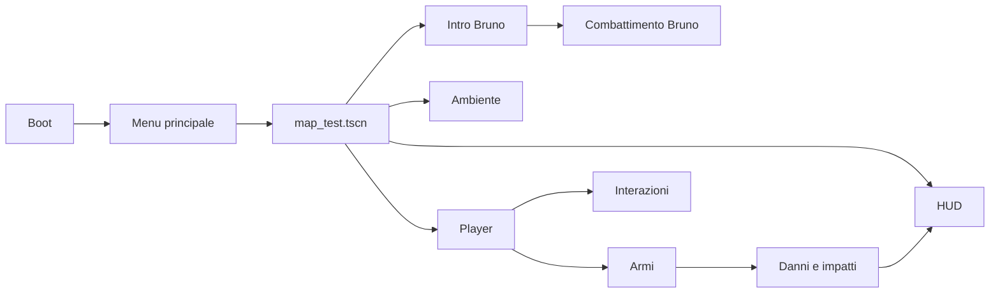

# Project Blob — architettura operativa

**Audio Broccolo e switch invito 19/10:** `broccolo_lab_audio.gd` espone le cue e tagli per i sei nuovi usi; `play_one_shot` crea un player 3D temporaneo sul world root così il suono sopravvive al ritiro del proiettile/attore. Actor avvia voce/aura al solo preview trasformazione, root combattimento emette aura+pop su copia e associa i tre lanci alle clip; proiettile fa suonare l'impatto solo dopo danno salute effettivo. `BroccoloMapCombat` avvia/ferma la soundtrack e la riavvia prima del silenzio finale. `BroccoloEncounter` crea una OmniLight viola figlia del solo interruttore lampadario, pulsa entro raggio e si spegne dopo l'interazione.

**Handoff Broccolo 19/10:** `BroccoloPresentation._begin_shrink()` distingue la mappa dallo studio: nella mappa avvia lo stage `combat_ready` e segnala l'handoff senza scalare il modello; `BroccoloMapCombat` resta proprietario dell'unica riduzione con aura. La seconda regia sposta il root della presentazione a destra rispetto alla camera solo se la posa finale supera la verifica capsule; offset configurabile su `BroccoloEncounter`.

**Regia e VFX Broccolo19/10:** il marker `BroccoloCameraStop` guida una linea retta dalla posa FPS; la quota Y resta quella della camera, mentre X/Z sono quelli del marker. L'orientamento mira al personaggio durante il tragitto, validato con sweep e ray. Se la suoneria e' attiva, il suo playback governa il progresso della camera fino al cue risposta e avvia la clip con l'anticipo `answer_seconds`; senza sincronizzazione resta `camera_path_seconds`. La posa `mie/idle` è esplicitamente ciclica per tutta l'attesa, poi la sequenza della risposta la interrompe sul cue. La seconda cinematic non cambia. Il componente mappa collega al corpo principale e al pool la stessa PowerVFX del laboratorio, la stessa scena visual della sfera e BroccoloBurnStatus sul player reale. L'handoff avvia una trasformazione da scala intera alla scala boss, attivando l'aura prima del combattimento; le copie conservano emersione dal corpo e direzioni casuali.

**Energia/incendio Broccolo18/10:** root esporta `energy_visual_scene` e `burn_status`; il componente mappa collega le stesse scene del laboratorio al proiettile e al Player. Actor passa i link al proiettile; Energy conserva fisica/danno esistente e usa il visual opzionale. Sweep raccoglie collider sul punto unsafe per distinguere impatto player da AoE; solo danno valido/LOS e impatto diretto chiamano ignite sullo stato collegato allo stesso target. BroccoloBurnStatus mantiene timer singolo rinnovabile, danno periodico e cleanup su morte/stop. Visual riusa PowerVFX, si separa al contatto per espansione0,4s; gruppo broccolo_energy_visuals gestisce pausa/cleanup anche dei visual separati. Warmup SubViewport prepara nucleo e shader canvas prima della lotta.

**VFX laboratorio18/10:** actor riceve PackedScene opzionale Preview Vfx Scene, null nel componente mappa. La scena test collega PowerVFX e lo spawner propaga lo stesso riferimento alle copie prima del ready. PowerVFX e persistente con shell shader, due CPUParticles e ring; materiali privati per istanza, mesh riusate, warmup con processo temporaneo ALWAYS per preparare anche particelle dei corpi pooled. Stato emerge muove la capsula dal principale, cresce il modello e rinvia scatter/corsa alla fine. Campo nullo mantiene ramo emissione storico e default shader equivalenti. Nuovi parametri rim impostati solo con profilo; niente nuove impostazioni nella mappa o modifica cinematic. Dopo approvazione riusare questa risorsa senza duplicati.

**Broccolo mappa18/10:** `broccolo_map_combat.gd` estende il controller laboratorio e la scena omonima e figlia dell'encounter con nome BroccoloMinionSpawner, quindi riceve configure dall'handoff esistente. Nessun input/camera debug nella mappa. Pool di attori costruito una volta, reset al respawn e ritorno dopo dying; mesh testa morph condivisa con valori per istanza. SubViewport prepara pipeline GPU. Grafo AStar multiquota costruito in porzioni, tre porte escluse solo dalle query di navigazione; collisioni reali conservate. AI entra in gate, salta e chiede request_enemy_open al battente abilitato; usa apertura normale senza arretrare il player. Configurazione flag sul door_setup e propagazione tramite integrazione, default false. Salvataggio main.broccolo.combat con priorita36 dopo encounter35, vittoria persistente e blocco salvataggi durante lotta. [Guida](BROCCOLO_COMBAT_LAB.md).

**Laboratorio ruoli/audio17/10:** `broccolo_lab_role.gd` su figli Roles serializza strategie Assaltatore/Lanciatore/Aggiratore e tuning; lo spawner riempie i ruoli mancanti. Actor riceve role prima del ready, usa profilo con distanza/attacchi/caccia distinti; principale regola distanza/cadenza in base alla propria salute. Reazioni senza blend, copie invulnerabili nello stato hurt, HP/barra separati. `broccolo_lab_audio.gd` su figlio Node3D gestisce3player audio3D (voce/passi/azioni), stream serializzati e bocca RMS; root arbitra una sola esclamazione contemporanea. `broccolo_lab_energy.gd` usa cast_motion sferico, esplosione singola occlusa e danni al solo player; pausa/stop/defeat gestiti dal laboratorio. Intenzione di movimento separata dalla velocity per rilevare incastri anche con steering fermo. [Guida](BROCCOLO_COMBAT_LAB.md).

**Laboratorio running17/10:** controller attore aggiunge fasi locomotorie idle/start/run/turn/stop/jump/land/walk, separate da combat state. Running ciclica su copie private; yaw root dell'inversione compensato nel runtime, rotazione affidata al corpo fisico. Cadenza running/walking derivata dalle curve con_spostamento e dalla scala, mentre AI usa in_place e collisioni CharacterBody. Copie scatter iniziale0,8s lungo direzioni casuali separate e aura arancione debole; scala0,17 con capsula/grafo coerenti. Root laboratorio esporta Start In Fps/Auto Combat e separazione emissioni; arma FP nascosta nella camera studio, ripristinata in FPS. Scena utente broccolo.tscn e originali animazioni intatti. [Dettagli](BROCCOLO_COMBAT_LAB.md).

## Laboratorio boss Broccolo — 17/10

`scenes/levels/broccolo_combat_test.tscn` compone arena fisica, istanze player/HUD con override locali e `broccolo_lab_actor.tscn` (scena Broccolo ereditata). `broccolo_combat_lab.gd` gestisce studio/FPS, grafo AStar3D locale, emissione dal principale e cap/cooldown. `broccolo_lab_actor.gd` gestisce stati shrink/chase/show/attack/hurt/preview/dead, copie private delle Animation in_place, danni HP per boss/impatti per copie, salti CharacterBody e reazioni. Figli Moves con `broccolo_lab_move.gd` serializzano clip/tipo/timing/danno/portata/impulso. Aura e burst dedicati, sangue `melee_feedback.gd` e onda `zombie_attack_arc_3d.gd` condivisi senza modifiche. HUD usa API `update_boss_hud` e texture broccolo.png solo sull'istanza del laboratorio. Nessuna integrazione nell'encounter esistente, nessun save participant o nuovo slot. [Guida e limiti](BROCCOLO_COMBAT_LAB.md).

## Stato regia Broccolo 17/10

Playtest utente approva la prima cinematic con percorso a velocità uniforme e rotazione sincronizzata all'avanzamento. La seconda cinematic era stata congelata in precedenza. Entrambe sono fuori scope per la prossima fase: lavorare alla boss fight soltanto nella scena di test dedicata finché comportamento, animazioni ed effetti non saranno verificati.

## Aggiornamento 17/10/2026 — root motion coreografia Broccolo

In modalità mappa il presenter applica ogni frame le curve Hips di `dancing3`, `dancing2`, `dancing` al CharacterBody, trasformate nella direzione corrente del modello. `BroccoloEncounter.dance_motion_scale` (default0,5) scala uniformemente il tragitto senza alterare clock e pose. Fixture7,12m non scalati; con la scala attuale3,56m. Mappa campionata con capsula: zero contatti con l'ambiente.

**Broccolo, camera e player:** il dolly iniziale avanza2,8m prima della curva. Durante lo stage `dance`, il planner confronta nove direzioni arretrate entro60° dalla linea camera-attore e sceglie il percorso libero migliore, fino al massimo Inspector `dance_camera_retreat_distance` (1m/7,5s); nella mappa attuale sceglie una diagonale−15° e0,63m. Sweep sferico e `CharacterBody3D.move_and_collide` limitano camera e player. La camera resta puntata su Broccolo; alla fine il player mantiene la posizione orizzontale raggiunta e allinea yaw/pitch prima del ritorno FPS. Il sequencer esistente continua a fare shrink e a emettere `combat_ready`, che avvia lo spawner dopo il rientro camera.

**Danza Broccolo nella mappa:** `broccolo_encounter.gd` tiene `travel=false` nella seconda presentazione. `broccolo_animation_preview.gd` ignora il root motion delle danze e applica alla sola `mie/dancing` un avanzamento frontale massimo di0,35m mentre la traccia verticale delle anche segnala il salto. Dialogo e `dancing3`/`dancing2` restano sul posto. Soglia e distanza sono parametri Inspector; fixture e mappa verificano fermo pre-salto, movimento e ingombro.

**Seconda cinematic Broccolo — correzione18/10:** la radice importata presenta il fronte del modello sul +Z locale, mentre `Node3D.look_at` orienta il -Z. `actor_facing_offset_degrees` (default180°, Inspector) compensa il modello e viene applicato dopo il reset eseguito dal presenter. Test verifica il +Z verso il player all'avvio e dopo1,5s di dialogo.

**Broccolo fase due18/10:** `BroccoloEncounter` avvia la phone presentation all’88% di un dolly3,25s. Il planner usa `spawn.global_position - basis * root_motion_finale` per iniziare dalla parte magazzino e finire sul marker intatto; attuale risoluzione mappa yaw−87°, lane0. Avvicinamento player entro2,4m riusa il controller condiviso preservando l’attuale transform dell’attore; `combat_ready` chiude la camera e crea `BroccoloMinionSpawner`. Lo spawner rimpiazza gli eliminati mantenendo massimo3 cloni. `broccolo_minion.gd` usa il corpo del modello piccolo, collider indipendente, steering da ostacoli, attacco melee FlyingKick, danno arma, hit/death, salti e periodi sneak. La regola di vittoria/loot resta futura. Il telefono di lancio è un RigidBody3D separato dal telefono utente in mano, collisione ambiente, rimbalzo configurabile e cleanup dopo resting. [Guida](BROCCOLO_MAP_INTRO.md).

**Camera e luci Broccolo18/10:** l'inizio di `start_introduction` accende il circuito corridoio via setter idempotente, senza simulare E né emettere `player_toggled`. La direzione deriva dagli interruttori ingresso/lampadario. Prima cinematic: dolly3,25s, tratto rettilineo2,8m e curva raccordata; campionamento128 punti e riparametrizzazione per lunghezza d'arco uniformano la velocità. La posizione della prima camera segue direttamente il percorso con sweep sferico; l'orientamento interpola dalla posa iniziale alla direzione del percorso sullo stesso progresso. La seconda cinematic resta distinta: posa FPS mantenuta e proprio smoothing del retreat. L'utente ha confermato il movimento della prima in gioco. [Guida](BROCCOLO_MAP_INTRO.md).

**Seconda cinematic Broccolo18/10:** distinto dalla prima rotta: la camera parte e resta nella trasformazione corrente del player, con orientamento diretto verso l'attore e senza dolly ingresso/sinistra. Al cue il modello guarda il player; `presentation.travel=false` conserva gli spostamenti delle animazioni scheletriche ma non trasla il root durante dialogo/danza nella corsia stretta. In `broccolo_phone.gd` il prop separato riceve direzione orizzontale dal delta del BoneAttachment della mano al frame di rilascio; il forward dell'attore è solo fallback se il gesto non produce un delta misurabile. Test dedicato `--cinematic-only` controlla fixture e mappa senza avviare lo spawner.

**Revisione telefono Broccolo18/10 (implementazione corrente):** BroccoloEncounter.trigger_switch collega il Lampadario Magazzino, pausa voce23s. PhonePresentation riceve telefono agganciato, scena `smartphone.glb` e AnimationPlayer; il sequencer passa `stage_changed`. L'istanza originale resta figlia del BoneAttachment senza scrittura di trasformazioni. A0,76s di `trow2` viene nascosta e una seconda istanza Node3D del GLB parte in avanti/alto, con gravita' visiva3,5m/s² e durata1,4s; nessun RigidBody o collider. Il flag completed viene fissato quando inizia la camminata anche se il lancio e' gia avvenuto, così il restore non riporta la visibilita iniziale. Snapshot/reset puliscono la copia. [Guida](BROCCOLO_MAP_INTRO.md).

**Broccolo mappa17/10:** BroccoloEncounter usa riferimenti scena esportati (marker, due switch, player/HUD) e percorso NetworkPuzzle. ZoneLightSwitch emette player_toggled solo nel comando riuscito; restore/blackout non emettono. Factory prepara broccolo_map_presentation prima del trigger; modalita map_presentation del controller studio omette ambiente/camera/UI/input, mantiene copie Animation e bocca RMS. Root motion telefono attiva in mappa, rig_basis locale per rispettare rotazione; lateral_motion_scale0,2 solo sulla traiettoria, distanze avanti/indietro e pose originali. Planner campiona200punti con capsula0,32, preferisce93° dal marker senza traslazione, evita scaffale/parete; eventuale assestamento/angoli limitati esportati. Camera/lock separati, IDmain.broccolo.encounter/priorita35, salva completed/actor_pose e ricrea idle senza voce. Voce/musica map-only ALWAYS con notifica pausa esplicita, cosi unpause globale non annulla la pausa speciale del lancio. Secondo discorso/combat non collegati. [Guida](BROCCOLO_MAP_INTRO.md).

**Configurazione player17/10:** player.gd conserva riferimenti e algoritmi FPS, espone le costanti di tuning come proprieta esportate (stessi nomi), max_health/starting_health e Dictionary[StringName,int] starting_inventory. Inizializzazione item aspetta un frame per i setup differiti; se SaveManager.restoring aspetta restore_completed, omette grant quando checkpoint non vuoto; apply_save_state marca comunque la dotazione gia' applicata. Weapon._ready legge possesso/caricatori/carica e selezione iniziale, riusa apply_save_state per posa/HUD del solo equip iniziale. Checkpoint reale resta prioritario con formato invariato. Camera.use_saved_fov defaulttrue preserva preferenze. ItemPickup imposta nome/colore predefiniti in _init, prima della deserializzazione, per rispettare gli override scena. Nessuna modifica a SaveManager/InventoryManager in questa estensione. [Guida](INSPECTOR_CONFIGURATION.md).

**Inspector17/10:**12figli di WarehouseDoors con warehouse_door_setup.gd @tool costituiscono la configurazione serializzata; source_visual/panel_source tipizzati, ID/runtime_name espliciti, asse/cardine/angolo, serratura, audio, autoclose e outline. Il factory legge i figli, deriva opening_normal da cardine/segno angolo e mantiene controller nella radice/ID storici. Preflight valida prima di spostare geometria; editor warning su duplicati/riferimenti. Entrambi gli @tool evitano costruzione runtime nell'editor. Genitore espone lettore, credenziale, tempi e colori fingerprint; associazione per flag e non ultimo figlio. Porta base/interruttore/zone_light_switch hanno gruppi e descrizioni `##`, API e dati precedenti invariati. [Guida](INSPECTOR_CONFIGURATION.md).

**Ingresso/lampadari17/10:**6circuiti/12Light3D/18copie materiali. Nuovo main.lights.warehouse_entrance su comando ingresso→Omni dedicata e Luce Tonda_006 (2materiali). Il comando lampadari seleziona Lampadario/_001 e usa nuovo export opzionale emission_texture_override di zone_light_switch; applicato solo ai materiali duplicati. PNG chandelier_emission recupera bytes della maschera GLB, perché la texture estratta esterna era nera. Albedo/normal e asset condivisi intatti. [Guida](WAREHOUSE_ZONE_2026-10-15.md).

**Completamento emissione lati17/10:** emissive_visual_roots del corridoio ora punta ai6gruppi Luce Tonda, non alle sole mesh centrali; la ricorsione esistente include12materiali (centro03_light + corpo01_black_metall per lampada). Altri2materiali mirror_light invariati. Nessun cambio script runtime o asset importati. [Guida](WAREHOUSE_ZONE_2026-10-15.md).

**Emissione magazzino17/10:** zone_light_switch esporta emissive_visual_roots; prima del ready condiviso prepara copie locali dei soli BaseMaterial3D emissivi delle mesh selezionate. `_set_lights` applica anche emission_enabled, incluso blackout/restore. Tre circuiti di map_test collegano6light_003_03_light_0 e2mirror_light DX/SX; nessuna modifica ai materiali importati, carter o lampadari.038 invertita su richiesta utente a−90°/+X verso giocatore/scale, stessa persistenza/geometria. [Guida](WAREHOUSE_ZONE_2026-10-15.md).

**Magazzino17/10:** WarehouseDoors passa8→12configurazioni, aggiunge WarehouseGrid013/014/015 (+Z) e WarehouseStairs038 (−X verso pianerottolo), senza chiavi. Warehouse_swing_door aggiunge guard altezza all'arretramento; evita influenze tra piani. Scena/luci/gruppi invariati; zone_light_switch ricorsivo comanda ora11luci su5circuiti. Test passaggio door calcola quota dal pivot elevato, fixture luci include discendenti annidati e conta le luci effettive. [Guida](WAREHOUSE_ZONE_2026-10-15.md).

**Porte magazzino15/10:** WarehouseDoors/warehouse_doors_integration.gd configura otto warehouse_swing_door.gd derivati da door.gd senza modificarlo. Pivot mondiale, pannelli/maniglie reparent preservando pose, telai fermi, AnimatableBody3D layer3 e Area3D. Tre chiavi pre-registrate da InventoryManager, persist main.door.warehouse.*, restore silenzioso, chiusura occupata e controllo player nel movimento. CEDFingerprint/warehouse_fingerprint.gd sul Plane_019 usa ced_fingerprint o scan(authorized), LED aggiunto senza ripitturare materiali, grant10s consumato aprendo/scaduto se non apre. F4 non assegna chiavi/impronta. Solo map_test configura RegiaIntegration.player_passage_radius0,32 per i bagni stretti; nessuna modifica ai controller condivisi/FPS. [Dettagli](WAREHOUSE_ZONE_2026-10-15.md).

**Accesso test magazzino15/10:** nodo WarehouseTestAccess in map_test con scripts/debug/warehouse_test_access.gd. F4 solo OS.is_debug_build, prima della cinematica/combat: sospende process/input dell'encounter, sblocca NetworkPuzzle in RAM e apre l'uscita con il controller sicuro esistente. Partecipante transitorio debug.warehouse_access blocca salvataggi quando attivo; nessun cambio a SaveManager o controller condivisi. Reload ricrea lo stato normale. Suite warehouse_test_access_test.gd sulla mappa reale passata.

**Luci magazzino/bagni15/10:**5MeshInstance3D nuove di map_test usano zone_light_switch.gd, subclass dell'interruttore condiviso invariato. Collider maskinterazione2 calcolato da AABB, controllo ricorsivo di gruppi o luce singola, ConnesiPower, click/outline/E ereditati.5ID main.lights.*, registrazione differita dopo setupmappa, restorepriority20 e ripristino silenzioso. Nodi luci non riparentati; transform/materiali/energie preservati. [Mappa circuiti e limiti](WAREHOUSE_ZONE_2026-10-15.md).

**Presentazioni Broccolo13/10:** broccolo_presentation.gd separato dallo studio, stati risposta/phone/throw/walk/idle e dialogue/dance/shrinking/combat_ready. Soglie clock voce22/21s, crossfade0,55s senza seek continuo, pausa audio durante throw preservata anche dopo pausa/ripresa generale. Gesti talk1–4 reimportati e adattati, clip duplicate RAM; root motion cumulativa e posizione conservata ai passaggi. Musica sottofondo−16dB nel secondo discorso, fade prima del ready; segnali intro_ready/combat_ready senza AI. [Guida](BROCCOLO_MOUTH_AND_PREVIEW.md).

**Broccolo studio — 13/10:** MouthPresentation sostituisce soltanto mesh testa a runtime con variante denti/tre morph, mantenendo transform/materiale. Preview separata duplica23Animation in RAM e trasferisce rootX/Z all'attore; voce RMS tramite componente Bruno invariato, intro→danza audio-driven→scala nominale20cm. [Dettagli](BROCCOLO_MOUTH_AND_PREVIEW.md). Nessuna AI/minion/mappa.

**Timing chiusura porte — 12/10:** `door.gd.close_sound_at_start` esportato, default false conserva suono a battuta. Se true, close_door riproduce subito e non lascia close_sound_pending. Solo Contatori_Sx_SportelloDx/Sx in map_test opt-in; apertura e API movimento/forced_open invariate.

**Faro Angelastri combat — 12/10:** `angelastri_encounter.gd` acquisisce OcchioDiBue dopo configure del CharacterBody combat, nei percorsi dialogo/F11/restore fight_ready. Target è il corpo mobile, automatico Bruno disabilitato temporaneamente; collider del target escluso dal ray di occlusione. Snapshot originale conservato una sola volta e ripristinato su sconfitta, morte player, riavvio test, abort/uscita. Controller condiviso `bruno_boss_spotlight.gd`, parametri luce e AI invariati.

**Reimport edificio14 — 12/10/2026:** parentdelcolliderBoxdelrack è ora `connesi_building_test2/Rack Regia/L_1a8b6df6_73d4_4ad3_8f47_3b570b4ecf40_I2`, conserva StaticBody3D/CollisionShape3D e BoxShape3D_wcoao esistenti. Il vecchio parent commerciale non esiste più nell'import. [Continuità/benchmark](CONNESI14_REIMPORT_BENCHMARK.md).

**Mirino globale:** HUD crea un Control project_blob_reticle sotto Interface e nasconde CrosshairImage originale mantenendolo compatibile con vecchi riferimenti. Oggetti/pulsanti usano focused_interactable dell'InteractionSystem esistente; nemici riconosciuti lungo antenati del collider WeaponRay tramite take_damage (Bruno/Angelastri inclusi). Campionamento20Hz, apertura/tinta interpolata; niente modifica alle interazioni/AI. Onda attacco zombie: ImmediateMesh68 triangoli, unshaded alpha, niente ombre/luci, settore uguale al range/cone di danno, svanisce0.35s.

**Combattimento Angelastri:** al ritorno del secondo incontro encounter crea angelastri_combat.gd, CharacterBody3D, e vi trasferisce il modello già caricato conservando posa. Collider riceve melee take_damage, take_bullet_hit/try_dodge_shot sempre senza danno. Stati chase/attack/bite/dodge/hurt/dead, impatti singoli su durata reale, lock/rilascio player, HUD CanvasLayer in alto. Weapon conserva 0–3 e aggiunge racchetta 4, possesso InventoryManager/sblocco fight/slot5/save opzionale. UI Usa/Riponi soltanto dopo sblocco. Preview riusa secondo incontro e pre-carica voce; patrol ruota il modello per non farlo orbitare rispetto al root offset. [Guida](ANGELASTRI_COMBAT.md).

**Evento Angelastri:** controller separato angelastri_encounter.gd, stato RefCounted angelastri_event_state.gd e nodo map_test. Osserva RegiaNetworkState.changed e ConnesiPower.power_changed; non modifica i sistemi. Soglia da collider porta esterna chiusa, lettura direzionale con isteresi. Riusa una presentazione prewarmata e la diagonale di danza nota, evitando istanziazione e sweep fisici alla terza uscita. I tre blackout aprono gli sportelli, spengono ConnesiPower, riproducono click vicino al player, notifica e risata 3D; riarmo 12 s. Regia audio-driven con uscita iniziale dal varco, raycast/volumi camion e quote basse durante danza, lock FPS/arma/HUD e prestito/restauro OcchioDiBue. Persistenza main.angelastri.encounter priorità 30, pausa/morte/restore; passeggiata limitata con capsule/terreno, vista reale per secondo discorso. Segnale fight_ready senza AI/arma racchetta ancora. [Contratti](ANGELASTRI_ENCOUNTER.md).

**Preview Angelastri in mappa:** nodo `AngelastriMapPreview` in map_test con controller dedicato F10/F11/F12. Istanzia il controller studio in modalità map_presentation senza camera/UI/ambiente. Curve bacino originali copiate prima della normalizzazione X/Z: offset cumulativi muovono realmente il modello e raycast segue il terreno. Dialogo resta stazionario e parte dalla posizione corrente, rivolto al player. Cleanup su F12/morte/restore; nessun partecipante salvataggio o AI. [Dettagli e limiti](ANGELASTRI_MAP_PREVIEW.md).

**Isolamento Animation:** nuova AnimationLibrary e duplicate(true) esplicito su ciascuna Animation esterna. Duplicare soltanto la libreria lasciava riferimenti condivisi: loop/normalizzazione ora avvengono su oggetti distinti verificati, senza scrivere risorse originali.

**Principale continuo:** _build_main_cues somma durate reali, pone secret a max(44 s, fine gesto precedente). _play_main_clip usa playback continuo e crossfade 0.55 s, aspetta completamento gesto precedente senza seek/pause per frame. _normalize_main_positions cambia X/Z delle chiavi POSITION_3D del bone 0 nelle sole copie private parlato/idle_new/talk_to_combat/looking; Y e rotazioni conservati, nessun track danza modificato. Fine voce → _main_tail attende fine reale idle_new (8.3333 s), poi talk_to_combat (1.1667 s), signal combat_preview_ready unico e posa finale ferma. Pause/replay espliciti per stati main/tail; intro/danza percorso precedente. Nessuna AI nel debug.

**Talking principali:** CUES[1] integra talking/talking2/talking3 e talking_secret. Prime tre ripetibili sul tempo voce; finite altre clip principali il fallback è talking. Finestra export main_secret_start/end (47/54 s) seleziona secret solo nel principale; non viene ripetuta/copiata negli altri cue. Clip valutate in copia privata, risorse/pose della scena ufficiale utente preservate. Test conteggio aggiornato per 33 mie/35 totali e controllo secret esclusiva nel test continuo.

**Preview discorso principale:** nuova scena debug riusa angelastri_mouth_preview.gd con preview_main_dialogue=true. start_presentation seleziona audio indice 1 e stage main_dialogue; fine voce passa direttamente a looking continuo, senza Thriller o AI. CUES[1] temporizza gesti privati su clock voce; finite le clip brevi usa looking invece di posa bloccata, talk_to_combat ripete, risata pilota motion.laughing. toggle pausa protegge avanzamento stadio anche quando AudioStreamPlayer.playing risulta false durante stream_paused. Preview intro/balletto invariata per export false.

**SingingArticulation locale:** inner class nel controller preview, process_priority=10/ALWAYS per applicare shape dopo BrunoMouthMotion RMS. Attiva solo se binding musica; fase su clock MP3−73.5 s, impulsi stilizzati 2.8 Hz con variazione 0.7 Hz, apertura limitata da motion.current_open e forme modulate. Smoothing 0.03/0.045 s, target zero su pausa/albero fermo; quando binding voce ripristinato non tocca shape. Nessuna modifica controller bocca condiviso o bus/musica.

**Cue secondo gesto intro:** runtime calcola cue pointing2 = intro_pointing_time + durata effettiva mie/pointing, poi ordina cue privati. Default 15.6 s, pointing non più ciclico. Nessun cambio risorse originali.

**Bocca al canto:** solo preview update_singing(time) commuta component.bind_voice tra voice e music al cue 73.5 s. Riusa unico BrunoMouthMotion/capture bus, send SFX prima e Music durante canto; non riavvia stream musica. stop_voice ripristina binding voce prima di reset; fine musica/stop/replay chiudono bocca e restituiscono bus Music. Controller bocca Bruno/Angelastri e scene ufficiali inalterati.

**Looking al posto di idle:** preview dance_start_delay=1.0; init/lead-in/fine danza usano mie/looking. Solo copia privata looking in LOOP_LINEAR; eliminate sync_rest e alternanza/timer verso idle, rest affidato al player continuo con blend 0.6 s e pausa esplicita. Clip idle originale conservata per combattimento e selezione manuale delle risorse.

**Timing/blend preview:** export dance_start_delay 2 s sottratto dal clock musica prima di selezionare danza, idle nel lead-in; fade/fine e durata test includono offset. intro_pointing_time 12 s aggiorna cue privato all'avvio. Dopo danza rest usa AnimationPlayer continuo con crossfade rest_blend_seconds 0.6 s; solo idle privato LOOP_LINEAR. sync_rest governa alternanza senza seek/pause ogni frame; toggle_presentation_pause sospende/riprende player anche nel rest. Clock audio e seek senza blend restano per voce/danze, preservando fix corpo congelato.

**Fix seek/pausa:** sync_sequence/sync_rest e ingresso rest cambiano clip con blend 0.0. La precedente sfumatura restava a peso zero sotto pausa, bloccando il corpo nonostante seek aggiornasse il tempo. Test ora confronta rotazioni delle ossa a 1/5 s per ogni danza, oltre a nomi/stadi. Pointing intro 11–18 s ripete la clip, senza pointing2; allineamento frase da confermare.

**Traccia lunga:** preview crea AudioStreamMP3 privato da byte reali di thriller.mp3, poiché import locale ancora descriveva il vecchio audio. Nuovo file 125.4102 s, loop condizionale risulta false per 111.3 s di danza; clock unico e fade finale invariati.

**Quattro balletti:** DANCES contiene nomi verificati mie/thrller_1…4; selezione cumulativa su clock musica, totale letto dalle risorse. Music usa copia privata del MP3; loop abilitato soltanto se sequenza supera stream.length. music_sequence_position compensa wrap con offset della durata audio. Risorse/scene ufficiali utente non mutate; 29 mie/31 totali.

**Preview automatica Angelastri:** export automatic_preview=true per F6; fasi intro/dance/rest nel solo controller debug. Fine voce avvia Music una volta; thrller_2 usa lo stesso playback continuo, fine danza ferma musica dopo fade e avvia idle. Rest valutato su delta di processo con pausa esplicita, idle ciclico e looking completo ogni 10 s. Replay resetta audio/stato/bocca/vista. Test manuale disabilita export prima dell'add_child; --presentation prova automaticamente tutti gli stadi in 85 s reali.

**Preview Angelastri fase 1:** controller isolato usa copie profonde di mie con LOOP_NONE, SFX voce → capture RMS esistente e Music Thriller indipendente. Sequenze valutate su get_playback_position dell'audio, seek deterministico e pausa AnimationPlayer; assigned_animation mantiene nome anche durante pausa. Dialoghi usano cue provvisori modificabili in RAM; danza passa da thrller_1 a thrller_2 ai 29.8333 s e termina ai 48.6667 s con fade finale. Camera figura intera segue bone 0 del GeneralSkeleton per root motion; closeup segue testa. Nessuna modifica scena ufficiale, modello, player, mappa o controller Bruno.

**Angelastri V2:** stessa struttura della variante iniziale, soltanto arcata superiore traslata +0.0012 m sull'asse verticale locale Blender; componente carica mouth_preview_v2. Controller/shape/apertura e rig invariati.

**Bocca Angelastri:** `angelastri.tscn/MouthPresentation` → angelastri_mouth.gd → head-only GLB su path verificato `sgt_Angelastri/Armature/GeneralSkeleton/mixamorig_Neck/Testa`. Mesh rigida, corpo skinnato separato; nessun retargeting. Tre shape e superfici pelle/cavità/denti. Voce opzionale, bind_voice riusa BrunoMouthMotion; senza voce nessun bus e bocca ferma. Preview isolata con confronto/manuale/animazioni originali, audio Bruno provvisorio escluso dalla scena nemico. [Dettagli](ANGELASTRI_MOUTH.md).

**Audio scorrevoli:** RegiaIntegration assegna `RegiaAudio.stream("sliding")` a open_sound/close_sound delle due istanze laboratorio/bagno. SlidingKeyDoor riusa AudioStreamPlayer3D SFX esistente, max_distance 12 m; stop al completamento del movimento o apply_persistent_state. Offset/velocità/collider invariati.

**Audio regia:** `regia_audio.gd` crea pool SFX locali 2D/3D e conserva stream MP3; terminale emette mouse/input campi/bip, lettore pagina all'inizio tween, NetworkPuzzle cavi alla fine posa e sblocco sulla transizione. ExitDoor usa stream nuovi nel DoorAudio base, apertura dopo arretramento e chiusura a battuta; pausa normale sospende audio/movimento. Restore silenzioso, nessun nuovo stato persistente o bus. [Contratto audio](REGIA_AUDIO.md).

**V6 denti texturizzati:** HEAD_FILE preview/integrazione `mouth_preview_v6`; limite destro X 0.225, recessione aggiuntiva 0.012 tramite smoothstep da X 0.17. PNG nativo Blender 512×64 con separazioni grigie sfumate, UV esistenti e collegamento Base Color della terza superficie, incorporato nel GLB. Nessun override nuovo o modifica controller.

**Arcate V5:** stessa struttura V4, intervallo X [-0.135,0.245] e altezze 0.017/0.011 per superiore/inferiore; profili quadratici e UV continue conservati. HEAD_FILE preview/integrazione punta a `mouth_preview_v5`, controller e animazioni invariati.

**Revisione denti V4:** sostituisce le dodici corone V3 con due fasce continue campionate in 16 segmenti ciascuna. Profilo/profondità interpolati su tre ancore del taglio labiale reale; UV continue 0–1 per arcata, materiale bianco avorio uniforme. Preview/integrazione caricano `mouth_preview_v4`; movimento e override invariati. Nessuna texture nuova applicata.

**11/10/2026 — denti Bruno:** preview e integrazione caricano la variante head-only `mouth_preview_v3`, tre shape invariate e terza superficie con materiale avorio opaco incorporato. Dodici corone leggere generate nel medesimo mesh; sei inferiori seguono jaw_open e tutte seguono le espressioni additive. Superfici esterna/cavità e loro override conservati, controller voce invariato. V2 resta disponibile come riferimento.

**11/10/2026 — uscita e prop Fritz:** RegiaAlienExitDoor specializza solo l'uscita aliena, senza modificare door.gd/player.gd: cardine world +X (destro guardando verso l'uscita dal lato +Z), open_angle +90 verso +Z. Prima dell'apertura esamina posizione player/volume battente e verifica il movimento all'indietro con PhysicsServer3D.body_test_motion; arretra mediante CharacterBody3D.move_and_collide, ripristina lo stato precedente della fisica e apre solo a distanza sicura. Pausa sospende l'arretramento, morte/cambio scena lo interrompono; NetworkPuzzle.blocks_saving include retreating. Restore battente conserva l'adattatore/ID esistente e non sposta il player. FritzPowerAdapter è un Node3D solo visuale con scatolina/innesto sulla ciabatta e tubo Curve3D fino al connettore DC individuato nell'atlante (1350,1533)/1600. Sempre presente, indipendente da kit/collegamenti. PC scala 2.1, deposito (8.75,1.0657,4.90), display circa 0.5985×0.3717 m; innesti derivati dalla stessa scala. NetworkTerminal.camera_target usa gli assi scalati dello schermo anche per l'alieno; clic già in coordinate locali inverse della chiusura. Scorrevole conserva la logica, cambia soltanto la notifica chiave.

**Ciclo kit e documenti 3D:** RegiaNetworkState aggiunge charger_collected/laptop_shutdown/laptop_recovered; connect_charger consuma l'item, shutdown_laptop richiede sblocco, recover_laptop verifica capienze prima di restituire kit e cavo PC. Il vecchio snapshot con caricatore collegato implica charger_collected, senza modificare schema SaveManager. NetworkTerminal aggiunge Start/Arresta ed esce con GameplayUI dopo shutdown. PC runtime 2.5×, Y=PI, display circa 0.7125×0.4425 m; porte fisiche ai lati dal transform importato. Caricatore originale nascosto dopo pickup, adattatore nativo sul tavolo e due cavi alla ciabatta verificata building/root e al PC. RegiaBookReader crea volume copertine/fogli e SubViewport delle pagine, riusa texture degli oggetti, anima la sfogliatura; nessuna patch alle mesh originali. RegiaItemIcons assegna icone SVG native a ogni definizione registrata; RegiaItemVisuals e il viewer di ispezione condiviso mostrano key/cavo/caricatore/PC/racchetta in world 3D separato, con ritorno inventario.

**Revisione visiva regia:** `regia_router_view.gd` riusa il contratto terminale per zoom sul Fritz e restituzione dei comandi; inoltra esplicitamente i clic ai pulsanti perché GameplayUI consuma gli eventi prima della fase GUI. LED montati tramite coordinate UV sull'atlante originale del router, senza legenda nuova. Portatile ancorato a LAPTOP_POSITION sulla ScrivaniaRegia; cavi da Curve3D campionata con terminali. Desktop logico 1024×576 renderizzato a 1920×1080 con font MSDF, coordinate pointer/test aggiornate alla risoluzione effettiva. `regia_windows_wallpaper.gd` e `regia_desktop_icon.gd` disegnano grafica nativa. Glifi condivisi Sylfaen armeno e texture manico rigenerata; indici password e schema persistente invariati. InventoryItemPickup usa il modello key_with_tag normalizzato a 0.34 m; raccolta e ID restano invariati.

**Puzzle rete regia 10/10/2026:** RegiaIntegration crea NetworkPuzzle solo con addon presente. RegiaNetworkState separa regole da wrapper/visivi/UI. `main.regia.network` restore priority 30; `main.door.regia_exit` battente esistente. Portatile/item/cavi/configurazione/WiFi/racchetta/luci persistiti; Online/LED derivati, negoziazione 3 s. GameplayUI aggiunge open_puzzle_panel e ritorno inventario da esame; NetworkTerminal implementa il contratto camera_target/set_terminal_active/handle_pointer con requires_save_eligibility=false. ConnesiOS conserva il default can_save. Chiusura aliena figlia del battente, resta visibile dopo sblocco e si muove solidale; codice non ripetuto. [Nodi e contratti](REGIA_NETWORK_PUZZLE.md).

**SceneTransition condiviso, 10/10/2026:** load_scene(path, caption, show_loading) mostra prima la UI e carica PackedScene in thread; lascia copertura attiva al chiamante. transition_to cambia scena e attende inizializzazione; SaveManager usa lo stesso loader, ripristina inventario/player/partecipanti prima di reveal. Stage risorse 0–88, preparazione 90, ripristino 95, pronto 100; percentuale interpolata. PROCESS_MODE_ALWAYS e tween pausa PROCESS mantengono animazione durante restore. cancel_loading rilascia overlay e busy sugli errori. LoadingBlob disegna contorno deformabile e orbite; cornice e tema riusano inventario/menu.

**Collider player nella regia, 10/10/2026:** durante setup RegiaIntegration duplica la CapsuleShape3D del player e applica `player_passage_radius=0.35`, compatibile con i vani 0.795 m. Altezza e transizioni crouch conservate; player.tscn/player.gd invariati, altre scene mantengono default 0.4. La shape è locale all'istanza e ricostruita anche nel restore.

**Integrazione regia 10/10/2026:** `map_test/RegiaIntegration` → `regia_map_integration.gd` costruisce wrapper runtime delle tre porte/PC usando i visuali esistenti, aggiunge BossLootDrop e PersistentObject sui target reali. Mesh mobili e collider sotto AnimatableBody3D; frame fisso conservato. Creazione differita prima del restore; ID `main.*`, slot principale. Pannello regia e sei maniglie sotto pivot comune; SlidingKeyDoor ora accetta required_key vuoto. [Contratti e percorsi verificati](REGIA_MAP_INTEGRATION.md).

**Collisione Parete_013, correzione 10/10/2026:** `map_test/connesi_building_test2/Mura Interne Alte/Parete_013/StaticBody3D/CollisionShape3D` usa `resources/collision/parete_013_current.tres`, generata dalla mesh attuale. Il precedente concavo incorporato era geometricamente diverso e bloccava Bruno. Visiva/gruppi/transforms/navmesh/AI invariati. [Evidenze e generatore](BRUNO_PASSAGE_COLLISION.md).

**Integrazione bocca reale 10/10/2026:** `bruno_buozzi.tscn/MouthIntegration` scopre il controller intro il cui riferimento `bruno` coincide col parent; collega dialogue_player, boss_voice_player e BrunoDeathAudio sotto boss. Una sola istanza BrunoMouthMotion e un bus capture privato commutano voce con priorità morte > dialogo > combattimento, ripristinando routing precedente. Head V2 sostituita solo runtime, materiale/transforms originali mantenuti. Risata da animazione `laugh`, reazioni dolore/caduta/morte senza sorriso. Nessun nuovo segnale o modifica alla logica boss/cinematica.

**Bocca espressiva, revisione locale:** preview carica `mouth_preview_v2/bruno_head_mouth_preview.glb` (open/round/smile). Il controller audio pilota apertura e variazioni stilizzate; `laughing` attiva sorriso e apertura maggiore. Solo la preview imposta questo flag sul tempo 11.55 s della prima voce, verificato nel controller intro; non esiste riconoscimento automatico delle risate. Originale e precedente head-only conservati.

**Estensione isolata 10/10/2026:** [prova bocca Bruno](BRUNO_MOUTH_PREVIEW.md). `bruno_mouth_test.tscn` → `bruno_mouth_preview.gd` → istanza visuale del boss senza AI → nuova mesh head-only sul nodo originale `mixamorig_Head/output_unwrapped`. `BrunoMouthMotion` misura la voce su bus privato e pilota `mouth_open`; nessun collegamento nuovo alla cinematica reale.

Aggiornamento 08/10/2026: analisi statica locale e [baseline](BASELINE_SAFE_2026-10-08.md). Non è un audit completo di ogni nodo né un playtest.

## Avvio e sistemi globali

`project.godot` punta a `uid://cp2iy3c4fy8en`, risolto in `scenes/ui/boot.tscn`. `boot.gd` mostra i loghi e apre `scenes/ui/main_menu.tscn`; `main_menu.gd` avvia `scenes/maps/map_test.tscn`.

| Autoload | Risorsa | Responsabilità |
|---|---|---|
| SettingsManager | `scripts/systems/settings_manager.gd` | Settings persistenti, display, rendering, volumi |
| AudioManager | `scripts/systems/audio_manager.gd` | Bus, routing, musica menu |
| SceneTransition | `scripts/systems/scene_transition.gd` | Overlay, dissolvenze, caricamento threaded, cambio scena |
| PauseMenu | `scenes/ui/pause_menu.tscn` | Pausa, opzioni, ritorno menu |

Configurazione locale: feature Godot 4.7, fisica Jolt, driver Windows D3D12, viewport 1920×1080 e stretch `canvas_items`/`expand`. Godot 4.7.2 è riportato da README/PDF; eseguibile presente ma non avviato.

La mappa compone player/HUD, edificio, porte, TV/telecomando, impianto elettrico e insegna Connesi, scala, pickup, incendi/fumo, meteorite, intro Bruno, racchetta, boss, luci e ambiente combattimento. L'esistenza degli altri nemici e dei test VFX non dimostra che siano istanziati qui.

## Player, armi e impatti

`scripts/player/player.gd` estende `CharacterBody3D`: input, movimento, salute/morte, accovacciamento, passi e voce. Gruppo `player`. Riferimenti verificati: `Head`, `Head/Camera3D`, `Head/Camera3D/WeaponHolder`, `Head/Camera3D/InteractRay`, `CollisionShape3D`, `FootstepRay`, audio/timer passi. Leggere la scena prima di cambiarne la gerarchia.

| Comando | Input corrente |
|---|---|
| Movimento | WASD |
| Salto / sprint / accovacciamento | Spazio / Shift / Ctrl |
| Interazione | E |
| Sparo / ricarica | Mouse sinistro / R |
| Slot | 1–4; slot 4 gestito anche con controllo diretto del tasto |
| Torcia | F |
| Pausa | `ui_cancel` |
| Continua dopo morte | C, solo con file valido della scena corrente |
| Ricomincia dopo morte | N, sempre dall'inizio; file salvato conservato |

Predefiniti player: salute 100, velocità camminata 5, sprint 8, crouch 2,8. Il player inoltra i comandi al controller `scripts/weapons/weapon.gd`, che governa slot, possesso, munizioni, animazioni, audio, viewmodel, melee e batterie.

| Parametro predefinito nello script armi | Valore |
|---|---|
| Pistola | Danno 1, 4 colpi/s, caricatore 9, riserva 36 |
| SMG | Danno 4, 10 colpi/s, caricatore 30, riserva 120 |
| Melee | Danno 1, portata 1,6, cooldown 0,45 s |
| Torcia | Consumo 2/s, massimo 5 batterie di riserva |
| Muzzle flash | Durata 0,05 s |

Gli export possono essere sovrascritti nelle scene. Marker verificati in `scenes/player/player.tscn`: `PistolSocket/PistolMuzzleMarker` e `SMGSocket/SMGMuzzleMarker` sotto il rig braccia del viewmodel.

Pistola/SMG sono hitscan via `weapon_ray`, distinti dai proiettili di nemici/boss. Contratto danni: eventuale `try_dodge_shot(hit_point)`, quindi `take_bullet_hit(base_damage, hit_point)` o fallback `take_damage(amount)`; feedback hitmarker e numeri danno. Preservare l'eccezione al player nel raycast.

`spawn_bullet_impact()` usa `ImpactManager_Runtime`, gestore condiviso creato da `scripts/effects/impact_manager.gd`. Gli impatti leggono `surface_type` sul collider. I passi cercano invece gruppi `surface_rock`, `surface_tile`, `surface_parquet` su collider e antenati: preservare entrambi i contratti.

## Interazioni e scala

`scripts/systems/interaction_system.gd` risale dal collider ai genitori cercando `get_interaction_name()`, `get_interaction_action()` e `interact(player)`. Colore e focus sono opzionali: `get_interaction_color()` e `set_interaction_focus(enabled)`.

`scenes/ui/interaction_system.tscn` è montata nel player; ray path predefinito `../Head/Camera3D/InteractRay`. Il codice locale libera focus/prompt prima del pickup e sospende focus se `Interface` della HUD è nascosta: presente, runtime da confermare.

La scala usa `scripts/interactables/ladder.gd`: root `Node3D`, `InteractionBody/CollisionShape3D`, quattro `Marker3D` chiamati `BottomAttach`, `TopAttach`, `BottomExit`, `TopExit`. Layer interazione 2/mask 0, collider fisico separato. Marker riferiti ai piedi, uscite su pavimento solido fuori dai collider. Input/movimento FPS e collisioni vengono sospesi durante la salita e ripristinati all'uscita. [LEGGIMI_SCALA.txt](../LEGGIMI_SCALA.txt) conserva la procedura V1: verificarla contro il codice corrente, senza assumere che ogni istruzione storica sia ancora applicata.

## HUD e volto

`scripts/systems/hud.gd` aggiorna salute, arma, munizioni, batterie, missione, feedback, morte e boss; gruppo `hud`.

`HudFaceController` (`scripts/systems/hud_face_controller.gd`) estende `TextureRect` ed è collegato a `Interface/HudBar/FacePortrait` in `scenes/ui/hud.tscn`. Gruppo `player_face`, API `set_health(current,max)` e `react(name,severity)`. Immagini `assets/ui/face/stato1_1.png` … `stato4_20.png`.

Quattro stati con soglie predefinite 75/50/25%, 20 frame ciascuno. Priorità: idle 0, focus 30, pickup_small 50, pickup_major 60, hit 80, critical 100. Preservare l'interruzione da danno e l'anti-restart durante raffica SMG.

TESTATO UTENTE secondo PDF: pickup_major per pistola/SMG/torcia, pickup_small per munizioni/batteria accettata, determined per sparo, grunt per melee e dolore. `alert`/`focus` sono disponibili, non automaticamente collegati. `hit_random` non implementa danno direzionale reale. Tabella frame completa nella baseline.

## Nemici, Bruno e cinematica

`scenes/enemies/bruno_buozzi.tscn` usa `scripts/enemies/bruno_buozzi.gd`, `NavigationAgent3D`, stati cinematici/combat, racchetta, tennis/onda, scudo, percezione, anti-incastro, animazioni e tre segmenti salute.

Default script: `max_health=180`, headshot height 1,55/multiplier 2. La scena locale imposta `max_health=90` e `start_active=false`. La segmentazione usa `ceil(max_health/3)`. Leggere anche gli override mappa prima di concludere i valori runtime.

`scripts/cinematics/bruno_intro_controller.gd` gestisce camera/marker, TV e ducking, dialoghi, movimento/animazioni, blackout/rivelazione, blocco player, visibilità HUD e avvio boss. `scripts/vfx/bruno_fight_environment.gd` e `scripts/environment/bruno_boss_spotlight.gd` governano musica, luce e ripristino ambiente. Preservare i gruppi `bruno_intro_blocker` e `navigation_source`.

IA base: `scripts/enemies/enemy.gd`, rilevamento/memoria/LOS, inseguimento, melee, schivata e magie. Varianti Carloni e copie storiche vanno distinte dai riferimenti attivi prima di interventi o eliminazioni.

## Maglietta BetterBuozzi — aggiornamento 08/10/2026

Il corpo usa la nuova texture BetterBuozzi_Meshy_AI_Mutated_Tennis_Player_1004142620_texture_connesi.png tramite BetterBuozzi_connesi_material.tres, come surface_material_override/0 in scenes/enemies/bruno_buozzi.tscn sul nodo BetterBuozzi/Armature/GeneralSkeleton/Meshy_AI_Mutated_Tennis_Player_1004142620_texture. GLB e texture originale restano inalterati; il solo GLB conserva l'aspetto originale. La scritta è incorporata nelle UV e segue le animazioni senza nuovi nodi o script runtime. Parametri e verifiche nella [nota asset](BETTERBUOZZI_CONNESI_TEXTURE.md).

## Materiale dell'onda — aggiornamento 08/10/2026

L'onda attiva è assets/vfx/bruno_melee_banana3d/bruno_melee_banana3d.tscn. Core e Shell usano magical_waterball_fire_godot4.gdshader: superficie lilla con noise locale continuo, pulsazione 1,2 Hz / 18% e deformazione radiale 0,06 / velocità 0,8. Entrambi gli strati condividono fase e deformazione, attenuata alle estremità; il margine di culling 0,25 copre lo spostamento della configurazione corrente.

I parametri dissolve ed emission_boost mantengono il contratto del controller. La luminosità viene applicata all'ALBEDO HDR perché il render mode unshaded mostra direttamente quel colore. Nessuna modifica a traiettoria, crescita, durata, volume di danno o ostacoli. L'anteprima usa start_wave() con danno disabilitato.

## Impostazioni, audio e risorse

### Inventario e checkpoint — 10/10/2026

Tre autoload dopo SceneTransition: InventoryManager (Resource/quantità), SaveManager (slot/checkpoint/registro ID mondo), GameplayUI (inventario/PC/pausa/camera/input). Player/Weapon espongono get/apply_save_state; Bruno espone defeated e restore_defeated_state. Entrambi i menu offrono Carica; da morto C carica il file valido della scena, N avvia sempre da zero conservando il file, senza autosave.

`scenes/levels/inventory_save_test.tscn` allestisce player/HUD/Bruno/pickup reali con PC e porta prototipo; la mappa non istanzia ancora i nuovi componenti. PersistentObject adatta pickup/porte/evento/alimentazione/TV/ambiente; BossLootDrop registra sconfitta e chiave dinamica. SavePCStation usa SubViewport sul monitor e conversione ray → pixel per i clic. Identificatori, installazione, formato e verifiche nella [nota inventario e ConnesiOS](INVENTORY_SAVES_CONNESIOS.md).

Grafica attiva: InventorySkin con Theme/palette menu e BlobInventoryPanel con materiale privato dello shader boss_health_blob. IndustrialPanel non più referenziato. Card sopra HudBackground, coerente con Interface e nascosta in pausa; [I] INVENTARIO su una riga solo nei pickup. SVG chiave incorporato nella skin. SavePCStation conserva il desktop approvato; scena HUD/mappa inalterate.

select_scene_slot separa MAIN_SLOT user://savegame.cfg da TEST_SLOT user://inventory_save_test.cfg, preservando gli override dei test. La demo seleziona prima di creare il PC; menu iniziale torna al principale. read_checkpoint valida il contesto degli slot standard; has_scene_save confronta la scena per C/pausa. Load chiude PauseMenu con close_for_scene_change e cancella notifiche. Il checkpoint è assegnato prima di restore_completed, senza riassegnazione nella continuazione asincrona.

SettingsManager è la fonte centrale, archivio `user://settings.cfg`, segnale `settings_changed`; non ricaricare il file a ogni menu. Nel locale il player legge sensibilità dal file solo in `_ready()`, camera legge FOV dal manager; pausa aggiorna direttamente il FOV corrente ma non la sensibilità player. Vedere backlog.

| Bus | Destinazione | Livello impostato da AudioManager all'avvio |
|---|---|---|
| Music | Master | Volume opzioni |
| SFX | Master | Volume opzioni |
| Ambience | SFX | +2 dB |
| Player | SFX | −2 dB |
| Weapons | SFX | 0 dB |
| UI | Master | Volume opzioni |

Il manager imposta routing e livelli di categoria; il solo `default_bus_layout.tres` non descrive il mix runtime. Opzioni: 75% nominale, boost sopra. Stream/volumi armi e boss configurabili nell'Inspector.

Test: `scenes/levels/shooting_range.tscn`, `prototype_corridor.tscn`, `scenes/vfx_tests/`, diagnostica `scripts/debug/`. Non equivalgono a suite automatica già eseguita. Asset GLB ambiente, Blender/FBX e export possono essere solo locali: consultare stato/procedura per la riproducibilità.
# **Regia Broccolo aggiornata17/10:** primo dolly: posizione e rotazione interpolano progressivamente. Durante la danza la camera pianifica una griglia di punti liberi fino alla posizione della svolta iniziale; se nessun percorso è disponibile, usa un arretramento breve con sweep. `CharacterBody3D.move_and_collide` mantiene il player sulle stesse traiettorie con collisioni. Dopo l'uscita di Broccolo dal campo visivo, l'attore ruota verso il player; la posa finale viene salvata solo quando termina la prima transizione. Salto `mie/dancing` avanza configurabilmente fino a1m.
**Luci fight Broccolo 19/10:** `BroccoloMapCombat` salva `light_color` delle luci ambientali, applica la sfumatura viola e ripristina i valori esatti a morte, stop e uscita. Escluse luci figlie dei `CharacterBody3D`.
**Conferma playtest Broccolo 19/10:** tinta delle luci ambientali approvata dall'utente. `second_presentation_screen_right_offset` ha default Inspector0,45m, mantenendo la verifica di spazio libero.
